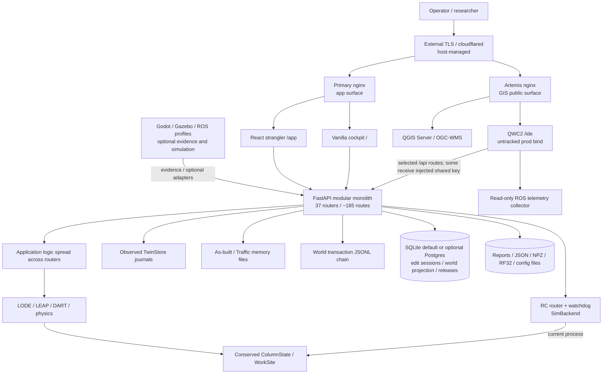
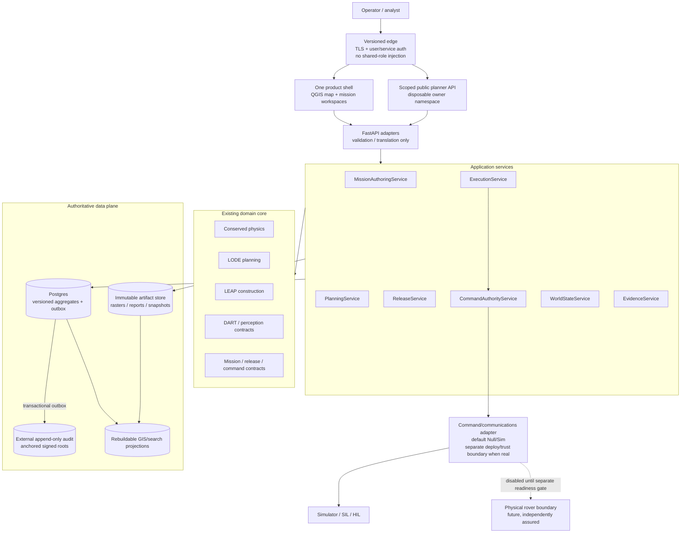
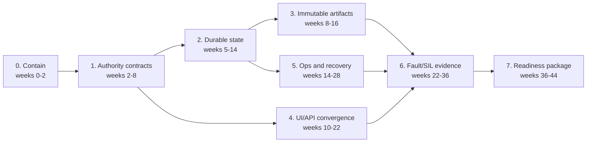

# STEWIE Full Architectural Review

**Review date:** 2026-07-16  
**Repository:** `/mnt/projects/stewie/code`  
**Reviewed revision:** `bad2e3cce335` (`main`)  
**Review type:** as-built domain, backend, frontend, security, data, deployment, and operational-readiness review  
**Decision scope:** the tracked repository at the reviewed revision. Ignored host credentials, generated builds, host services, and external mission hardware were inspected only where locally available and are not treated as reproducible repository evidence.

## 1. Executive decision

STEWIE is a substantial and credible **lunar construction planning, simulation, GIS, and mission-evidence research platform**. Its strongest architectural asset is the explicit conserved-physics authority: the repository separates the mass-conserving terrain state from observed estimates, remembered as-built terrain, rendered products, and learned or advisory components. The system also has an unusually broad automated test surface, explicit provenance labels, bounded API inputs, a simulator-only default command backend, and a thoughtful set of failure-compensation patterns.

STEWIE is **not ready to be represented or enabled as an operational rover-command system**. The decisive problem is not missing functionality; it is that the release-to-command authority chain is not yet closed. A valid live token for one mission/revision can currently authorize a command that names another published mission, lifecycle roles are programmatically supplied rather than bound to independently authenticated actors, release durability and critical audit writes are allowed to fail without invalidating authority, and legacy unbound execution/lowering paths remain reachable. Those conditions are incompatible with a defensible OPERATE boundary.

The recommended architecture is **not a microservice rewrite**. Keep the modular monolith and conserved domain packages. Introduce explicit application services and immutable command/release envelopes, make one durable store plus transactional outbox authoritative for governed metadata, publish multi-file state as immutable generations, unify the workspace/API contracts, and build every deployable surface reproducibly. This is achievable as a focused 9–12 month hardening program if live hardware integration and flight qualification remain outside the claim.

### 1.1 Readiness by declared mode

| Mode / use | Verdict | Architectural basis |
|---|---|---|
| Domain-library research and physics experiments | **GO** | Conserved `ColumnState`/`WorkSite` authority, strong invariant tests, deterministic seams. Results still require model-calibration caveats. |
| GIS-PLAN on controlled/internal infrastructure | **CONDITIONAL GO** | Useful QGIS/QWC2 and planner surfaces; require secret rotation, scoped public identity, reproducible QWC build, explicit degraded-terrain policy, and restore procedures. |
| TRAIN / EVALUATE | **CONDITIONAL GO** | Appropriate simulation/evidence posture if every synthetic, forecast, observed, and unavailable condition remains visible and non-promotable. |
| SIM-OPERATE / desktop SIL | **CONDITIONAL GO** | Real in-process conserved simulation, but process-local authority and file-backed state require the enforced single-process invariant and crash/concurrency gates. |
| OPERATE against a physical rover | **NO-GO** | Command target-binding defect, simulated approval identities, fail-open critical audit, unbound legacy paths, no production actuator adapter, and no HIL/field/flight safety evidence. |
| Flight/space qualification | **OUT OF SCOPE / NO CLAIM** | The repository contains no evidence sufficient for radiation tolerance, flight software assurance, qualified crypto/key custody, environmental testing, or mission certification. |

### 1.2 Priority decision

The next increment should be named **Authority and State Integrity Closure**, not “more autonomy” or “more UI.” Feature expansion before this closure increases the number of surfaces that can disagree about identity, mode, revision, terrain, or command authority.

The first release gate is:

> No operational command can be created, lowered, queued, transmitted, or acknowledged unless a durable, immutable release artifact binds the exact mission, plan, terrain/evidence basis, target namespace, actor approvals, and command payload under one verifiable identity; every security-relevant decision must be durably audited or refused.

## 2. Scope, method, and evidence limits

The review followed five independent lenses and then reconciled their conclusions:

1. **Lunar mission/domain integrity:** physics ownership, terrain/world/twin distinctions, provenance, frames, autonomy boundaries, GIS, construction outputs, and operational claims.
2. **Backend/platform architecture:** composition root, service boundaries, API contracts, persistence ownership, background work, concurrency, migrations, observability, and deployability.
3. **Security and command governance:** identity, roles, release, token binding, command eligibility, public proxy trust, secrets, audit, and failure posture.
4. **Frontend/HCI architecture:** QWC2, legacy cockpit, React strangler shell, workspace state, mode/authority visibility, API coupling, degraded states, and accessibility/test posture.
5. **Reliability and operations:** crash consistency, multi-process behavior, backup/restore, supply chain, artifact reproducibility, health signals, and verification gates.

Evidence came from source and configuration inspection, focused exploit reproduction, repository gates, the Python test suite, JavaScript unit tests, the React production build, and Compose model validation. No assertion in this report treats simulation as field validation or a locally present artifact as a tracked/reproducible deployment asset.

### 2.1 Verification snapshot

| Check | Result at review time | Interpretation |
|---|---|---|
| Documented Python command from `AGENTS.md` | **Collection failure:** 466 imports failed on `stewie_bodies` | The documented local command omits workspace-package paths; this is a reproducibility/documentation defect, not 466 product regressions. |
| Corrected Python suite (`PYTHONPATH=.:packages/stewie-bodies:packages/stewie-forge`) | **4,550 collected; 1 failed; all other executed tests passed, with skips** | The lone failure is the G1 capture portability test, whose child-process environment overwrites the corrected import path and omits `stewie_bodies`. |
| Browser/QWC/legacy unit tier | **585 passed, 0 failed** | Broad pure-JS adapter and presentation coverage. |
| React `npm run build` | **Passed** | TypeScript checking and Vite production build succeed. |
| React Playwright E2E | **16 passed, 0 failed** | Real FastAPI + built React shell in Chromium; this covers the migrated shell/panes, not QWC visual parity. |
| High-risk targeted Python gates | **38 passed, 0 failed** | Existing live-token, import-DAG, world-transaction, deploy-hardening, and edit-session persistence suites pass; they do not contain the AR-001 cross-mission case. |
| Compose configuration | **Passed** | `deploy/compose.yml` parses with the present environment. This is not a runtime deployment proof. |
| ATG | **Valid DAG**, 413 rows, only 14 declared edges | Mechanically valid but operationally almost flat: all 113 open rows are currently dispatchable at level 0. It is not yet a dependency-realistic delivery plan. |
| Requirements trace | 413 requirements; 320 cited by tests; 20 cited with `V != D` | Useful trace infrastructure, with a material declaration/evidence reconciliation tail. |
| Static-analysis ratchet | Passed against baseline; 73 baseline findings remain | No regression relative to baseline, not a clean static-analysis result. |
| Tracked-artifact gate | Passed; approximately 961.7 MB tracked | Policy-compliant today, but repository/data distribution cost remains high. |
| Cross-mission command authorization probe | **Unexpected HTTP 200 / accepted `goto`** | Confirms finding AR-001 at the HTTP adapter. The backend was `SimBackend`; no physical rover was driven. |

### 2.2 Limits

The review did not establish the runtime state of the public Cloudflare route, perform a destructive failover test, restore a production backup, build every optional Docker profile, validate QGIS rendering against a running production stack, connect to rover hardware, or establish radiation/flight assurance. Those are explicitly required evidence gates, not inferred successes.

## 3. System purpose and truthful product boundary

The as-built product is a **modular-monolith mission planning and simulation system** with optional visualization and robotics adapters:

- `stewie.physics` owns conserved terrain and rover-physics state.
- LODE compiles and schedules missions and produces plan/evidence views.
- LEAP decomposes construction structures into primitive work.
- DART/perception and navigation modules produce observation, localization, and hazard evidence.
- `stewie.twin` separates observed terrain, as-built memory, snapshots, and linked world-transaction identities.
- FastAPI exposes approximately 185 router-declared endpoints through 37 included routers.
- QWC2 at `/ide/` is the current GIS front door; the vanilla cockpit at `/` remains authoritative for many operational panes; the React `/app` surface is a strangler shell with only a minority of panes migrated.
- QGIS Server provides WMS/OGC rendering; optional ROS/Gazebo/Godot profiles provide simulation, evidence, or visualization adapters.
- The command router currently instantiates only [`SimBackend`](../stewie/server/routers/rc.py#L24). The ROS lowering route returns message-shaped dictionaries; it is not a proven actuator egress.

The honest top-level classification is therefore:

> STEWIE is a simulation- and planning-authoritative research environment with operationally inspired governance seams. It is not presently a live rover-control authority.

## 4. As-built architecture



### 4.1 Architectural strengths worth preserving

1. **Single conserved-physics authority.** The code makes a real distinction between float64 conserved runtime/checkpoint state and float32 render exports. Mass invariants and construction acceptance are heavily tested.
2. **World-state concepts are not collapsed.** Pristine terrain, observed twin state, remembered as-built changes, traffic effects, belief, plan identity, and render products have explicit types or stores.
3. **Provenance and mode honesty are first-class concerns.** Many endpoints identify SIM/FORECAST/observed/prior status, expose missing evidence, and refuse to fabricate host-gated results.
4. **Safety seams exist.** The RC watchdog, SAFE latch/re-arm behavior, command eligibility interlock, input caps, and default simulator backend are useful foundations.
5. **Broad executable verification.** Hundreds of Python and JavaScript tests cover physics, planner behavior, contracts, frontend adapters, security controls, and deployment invariants.
6. **Container hardening is materially better than a default research deployment.** The main backend/frontend images use digest-pinned bases, non-root users, read-only roots, capability drops, and hashed Python dependencies.
7. **The modular-monolith shape is appropriate.** A single deployable process is reasonable for the current team and domain. The needed improvement is stronger internal boundaries and state ownership, not network-distributed services.

## 5. Findings register

Severity is contextual:

- **P0 — OPERATE blocker:** can violate command/release authority or safety evidence if the live boundary is enabled.
- **P1 — production blocker/high risk:** can violate externally exposed security, durable correctness, recovery, or reproducibility.
- **P2 — material design debt:** increases inconsistency, maintenance cost, or operator error but is currently contained by another boundary.
- **P3 — improvement:** valuable hardening or simplification with limited immediate risk.

P0 findings do **not** imply that a physical rover was affected. The reviewed command backend is a simulator and the live-execution flag defaults off. They mean the code must not be promoted to a physical actuator boundary.

| ID | Severity | Finding | Current consequence | Required disposition |
|---|---:|---|---|---|
| AR-001 | **P0** | Live token is not checked against the commanded mission/artifact mission | Cross-mission token retargeting is accepted at the HTTP boundary | Exact target binding plus negative adapter tests |
| AR-002 | **P0** | “Signed release” is a role-labeled content hash; one request auto-supplies all lifecycle roles | No independently authenticated approval chain or cryptographic signer evidence | Authenticated actor attestations, separation policy, durable signature records |
| AR-003 | **P0** | Governed execution/lowering still has legacy unbound paths and release durability is best-effort | Executed/lowered content need not be the durable artifact that was approved | Require immutable revision for governed paths; confine legacy to sandbox/SIM |
| AR-004 | **P0** | Security/command audit writes fail open | Privileged action can succeed while its required audit record is absent | Transactional/fail-closed audit for critical operations |
| AR-005 | **P1** | Public GIS proxy injects a director-equivalent shared key; basic-auth file is mounted but unused | Anonymous users inherit an overpowered shared identity, quota, and audit actor | Scoped anonymous planner principal or authenticated sessions; no director key injection |
| AR-006 | **P1** | Governed state spans process-local caches, SQLite/optional Postgres, JSONL, NPZ, and best-effort projections without CAS | Multi-worker lost updates, split authority, and recovery ambiguity | Mandatory production DB, migrations, optimistic concurrency, outbox/reconciliation |
| AR-007 | **P1** | Multi-file scene publication is file-atomic but not snapshot-atomic | Concurrent readers can observe a mix of old/new rasters under an old commit marker | Immutable generation directory + atomic manifest/pointer switch |
| AR-008 | **P1** | Missing lunar DEM degrades to flat planning and a zero-based twin | An executable-looking plan or observed state can be produced without required terrain | Fail closed for release/operate; isolate and label explicit training fixtures |
| AR-009 | **P1** | Primary QWC deploy and host ingress are not reproducible from tracked source | Running UI/edge state can drift from the reviewed commit and cannot be reliably rolled back | Build QWC image/artifact in CI; version host manifests and hashes |
| AR-010 | **P1** | Observability, audit anchoring, and disaster recovery remain node-local and incompletely exercised | Degradation can be invisible off-host; restore/RPO/RTO claims are unproven | External metrics/logs, alerting, signed anchors, scheduled restore drills |
| AR-011 | **P2** | Three frontend generations carry incompatible workspace/role/authority models | Context and authority displays can disagree; trainee React role handling is unsafe at presentation layer | One generated workspace contract and role ladder; complete or retire surfaces |
| AR-012 | **P2** | “Bounded services” are labels over an acyclic import graph, with router/application/domain concerns mixed | Large routers and private cross-router imports increase blast radius | Application services, repository ports, public module APIs; remain a monolith |
| AR-013 | **P2** | Product/PRD/ATG/test instructions have drifted from the as-built system | Completion claims and local verification are hard to reproduce | Executable capability manifest, one verify entrypoint, dependency-realistic plan |
| AR-014 | **P2** | Nearly 1 GB of data is tracked directly in the code repository | Slow clone/build/review and growing artifact-governance cost | Versioned content-addressed data bundles with manifests and small CI fixtures |
| AR-015 | **P2** | Auth tokens are returned in JSON even when HttpOnly cookies are issued | Browser-accessible credential surface is larger than necessary | Separate browser and automation login/token flows |
| AR-016 | **P1** | Tests pass and expose the complete ambient environment to subprocess failure diagnostics | Unrelated local/CI secrets can be printed into pytest logs | Minimal allowlisted child environments and automatic log redaction |

## 6. Detailed findings and acceptance criteria

### AR-001 — Live token target binding is broken

**Evidence.** [`_enforce_live_token`](../stewie/server/routers/rc.py#L45) reconstructs the presented token and calls:

```python
require_live_token(token, token.mission_id, str(rev_hash), now=time.time())
```

The expected mission argument is taken from the token itself rather than from `body["mission"]` or the durable release artifact. The route separately checks only that the named command mission exists in the `live` namespace and that the revision hash exists. It never proves that:

```text
command.mission == token.mission_id == release_artifact.mission_id
```

A focused HTTP probe released and ran mission A, published mission B, enabled `STEWIE_ALLOW_LIVE_EXEC`, and sent mission A's valid token/revision while naming mission B in `/rc/command`. The endpoint returned HTTP 200 and accepted `goto`. Existing contract tests correctly reject a primitive mission mismatch, but the HTTP adapter supplies the wrong expected value and has no cross-mission negative test.

**Impact.** If a physical backend is added or the current live flag is enabled around a real egress, an authorization for one released plan can be retargeted to another published mission name. This is a command-authorization failure, even though the current in-process backend is a simulator.

**Required design.** Introduce a typed immutable `CommandEnvelope` containing at least `mission_id`, `release_id/content_hash`, `target_namespace`, `command_id`, `issued_by`, `issued_at`, `expires_at`, and the command payload hash. The command-authority service must load the release artifact and compare all identities before constructing an actuator command. Do not let the HTTP adapter choose its own expected identity.

**Acceptance.** All of the following must be proven at the adapter and application-service levels:

- token mission differs from command mission -> refused;
- artifact mission differs from token or command mission -> refused;
- revision differs, is missing, is not durable, or has a bad signature -> refused;
- namespace, target asset, actor capability, expiry, nonce/replay status, or command payload hash differs -> refused;
- exact artifact/token/command match -> accepted once and fully audited;
- mutation/property tests cannot make any identity field self-validating by comparing it to itself.

### AR-002 — The release record is immutable, but it is not an authenticated multi-actor signature

**Evidence.** [`SignedRevision`](../stewie/contracts/executive.py#L114) stores a deterministic SHA-256 content hash and a `signed_by` string. On release, `signed_by` receives the role literal (`"director"`), not the authenticated director identity, key identifier, signature, or time. [`run_lifecycle`](../lode/mission_lifecycle.py#L135) advances analysis, rehearsal, review, and release in one function using default role names. Both `/executive/advance` and `/executive/release-plan` invoke that whole sequence from one director-authenticated request.

The hash is useful for content identity, but calling it a signature overstates the security property. A content digest proves equality only when obtained through a trusted channel; it does not prove which person approved it or prevent a database writer from creating a new role-labeled record.

The same flow treats simulation completion and the programmatically generated `released` state as evidence for all live-token preconditions. Thus one HTTP actor can cause the system to populate nominal planner/operator/reviewer/director transitions and mint a live-looking token after a successful SIM run.

**Impact.** The system cannot demonstrate separation of duties, signer identity, nonrepudiation, or an approval ceremony suitable for operational command authority.

**Required design.** Model transitions as individually persisted attestations:

```text
Attestation = artifact_hash + transition + actor_id + actor_role_at_time
              + evidence_hashes + decision + timestamp + key_id + signature
```

Role authorization and separation-of-duties policy should be evaluated server-side against actor identity. A small mission may allow one person to hold several roles, but that must be an explicit policy decision and still produce separate authenticated decisions; it must not be simulated by default role strings. Use a managed asymmetric signing key or approved signing service, record algorithm/key version, and maintain crypto agility. Post-quantum or hybrid signatures can be evaluated later, but they do not repair missing identity, custody, and workflow semantics.

**Acceptance.** A release cannot be created by calling one “advance all” endpoint; every required transition has a durable actor identity and evidence; policy tests cover disallowed self-approval; signature verification works offline from an exported artifact; key rotation and revocation are tested; duplicate release of identical intent may create a distinct approval event without mutating the content artifact.

### AR-003 — Release durability and execution binding are optional on governed paths

**Evidence.** [`_persist_released_revision`](../stewie/server/routers/executive.py#L102) explicitly treats persistence as best-effort and returns a successful release when the durable write fails. [`_command_authority`](../stewie/server/routers/executive.py#L77) nevertheless returns `namespace: live` and `authorized: true` whenever an in-memory release object exists. The response can therefore claim command authority while `revision_persisted` is false.

[`/executive/run`](../stewie/server/routers/executive.py#L293) accepts a bound `revision_hash`, but also preserves a legacy path that rebuilds and auto-releases a mission from mutable client `orders`. The ROS lowering route likewise accepts either a durable revision hash or a mutable published mission name; its response explicitly returns `content_hash: null` on the legacy path.

The bound run also uses request-level `mission_id` in persisted records and live-token issuance instead of unconditionally adopting the signed intent's mission identifier. This creates another opportunity for identity drift.

**Impact.** “Released,” “executed,” and “lowered” need not refer to the same durable artifact. A storage outage can leave an apparently authorized but unrecoverable release. Mutable mission content can be lowered after an approval event without the immutable identity required for proof.

**Required design.** A governed release becomes valid only after the immutable artifact and all attestations commit durably. Operational run, lowering, scheduling, and command endpoints accept only `release_id`; every other mission input is derived from that artifact. Legacy order/name paths remain available only under an explicitly non-promotable `sandbox/sim` namespace and return no live token or command authority.

**Acceptance.** Injected DB failure makes release fail; no authority card/token is returned; all execute/lower/command records contain the same release and mission identities; attempts to pass mutable orders alongside a release are rejected rather than ignored; replay from the exported release reproduces identical command IR.

### AR-004 — Critical audit is fail-open and is not atomic with privileged state

**Evidence.** [`log_event`](../stewie/server/services.py#L157) fsyncs a JSONL line and records degraded health on `OSError`, but its contract explicitly “never raises into the request path.” Release, command, re-arm, authentication, administrative, and other privileged routes generally call it after the action or state transition. A failed write therefore permits the operation and merely changes an in-process health flag.

There is also a second hash-chained executive audit. Its hash chain is tamper-evident only while a trusted head exists elsewhere: a writer with access to the full file can rewrite the history and recompute every unkeyed hash. “Hash-chained” should not be presented as nonrepudiation.

**Impact.** The precise events that require durable accountability may be unrecorded during disk-full, permission, filesystem, or rotation failures. State and audit can disagree after a crash.

**Required design.** Classify actions by audit criticality. Command, release, approval, key/role administration, and safety-state changes must write state plus an outbox/audit event in the same database transaction or refuse. A dispatcher can copy events to append-only external storage. Periodically anchor signed audit roots outside the application host.

**Acceptance.** Fault injection at every audit/store boundary proves: critical action absent when audit commit fails; idempotent recovery after crash; no duplicate actuation on outbox retry; external alerts on backlog/degradation; exported audit chain verifies against an independently retained signed root.

### AR-005 — The public GIS proxy confers director authority through a shared identity

**Evidence.** [`role_of`](../stewie/server/auth.py#L229) maps `api-key` to `director`. [`artemis-nginx.conf`](../deploy/artemis-nginx.conf#L247) forwards generic `/api/` traffic without a credential but injects the shared key for selected exact locations including `/api/plan`, `/api/export/geojson`, `/api/structure`, `/api/construction`, `/api/resync/compare`, and several DEM metadata routes. The comments correctly warn that the key is director-equivalent.

The Compose file mounts an htpasswd file as an “interim basic-auth gate,” but no tracked nginx configuration contains an `auth_basic` directive. The public front door is therefore not protected by that mounted file. All proxy-authorized users appear to the backend as the same `api-key` actor and share process-local quotas. `/api/executive/run` has appropriately had key injection removed, but the remaining pattern still violates least privilege and actor accountability.

The ignored key and htpasswd sidecars were mode `0644` during the review. The key value was not tracked, but it was readable by ordinary local tools and must be rotated following this review.

**Impact.** Anonymous callers inherit an automation identity with director semantics for routes that should need only narrow planning/read capabilities. Individual attribution and fair-use rate limiting are impossible. Any future exact-location mistake can silently expose a privileged write.

**Required design.** Replace the shared director key with one of two explicit designs:

1. authenticated user sessions with normal roles, CSRF protection, and per-actor quotas; or
2. a dedicated `public-planner` service principal whose capabilities are statically limited to pure planning/read operations and whose writes go only to disposable, owner-scoped namespaces.

The backend, not nginx path selection, must enforce the capability. Use Compose/Kubernetes/system secret mechanisms or a restricted credential agent, not a world-readable include file.

**Acceptance.** No anonymous request resolves to director; an endpoint added under `/api` receives no implicit privilege; every request has a scoped actor and per-actor/IP quota; the key has been rotated; secret scans and file-mode checks pass; deployed configuration has an explicit tested access policy.

### AR-006 — Durable state is hybrid without one transaction or concurrency model

**Evidence.** [`db.py`](../stewie/server/db.py#L84) currently persists edit-session snapshots/audit, a world-transaction projection, and release revisions. Production Compose leaves `STEWIE_DATABASE_URL` empty by default, so SQLite on the data volume remains the default; Postgres/PostGIS is an opt-in profile. Runtime schema creation uses `Base.metadata.create_all` rather than managed migrations.

The authoritative world chain remains an fsync'd JSONL journal; terrain and traffic memories are files; missions/runs and several registries are JSON files; reports and scene products are filesystem artifacts. The database world table is explicitly best-effort and non-authoritative. Projection failures are swallowed without a durable repair queue or watermark.

Edit sessions cache mutable objects per process. [`_persist_session`](../stewie/server/db.py#L345) overwrites the row with the caller's current snapshot without an expected-version predicate. Two workers can load the same version, independently mutate it, and last-writer-win the database while both append conflicting audit version numbers. The global session-count/evict/insert sequence is likewise not serialized across database transactions. Similar file read-modify-write locks are process-local.

**Impact.** The single-worker deployment currently contains many races, but the invariant is documentary rather than a startup-enforced architectural mode. Accidental scale-out or overlapping tools can lose state. Recovery requires reconciling multiple authorities manually.

**Required design.** For production/governed mode:

- make Postgres mandatory and add versioned migrations;
- use `UPDATE ... WHERE version = expected_version`, unique `(session_id, version)` audit constraints, and transactional retries;
- store immutable metadata and event/outbox records transactionally;
- keep large rasters/point products in an immutable object/artifact store referenced by checksummed manifests;
- make one component authoritative for each concept and treat all mirrors as rebuildable projections;
- if single-process remains supported, assert it at startup and in deployment tests rather than relying on comments.

**Acceptance.** Two-process concurrent mutation tests produce either a serial history or an explicit 409 conflict; kill-at-every-write-boundary tests recover without split authority; migrations upgrade and downgrade a prior database; projection reconciliation reaches a known watermark; backup restore meets stated RPO/RTO.

### AR-007 — Scene publication is not a coherent atomic snapshot

**Evidence.** [`save_scene`](../stewie/twin/io_fields.py#L57) atomically replaces each raster, deletes stale optionals, and writes `metadata.json` last. This guarantees that an individual file is not torn. It does **not** make an update to an existing scene directory atomic: the old `metadata.json` remains visible while rasters are replaced one by one, so a concurrent reader can load old metadata with a mixture of old and new raster generations. Removing an optional raster creates a similar mid-publication window. Current commit-marker tests begin with a new empty directory and do not exercise concurrent republish/read.

**Impact.** A renderer or planner can observe a coherent file size but incoherent terrain fields. For conserved data, that can create false mass/state relationships.

**Required design.** Write a complete immutable generation under a unique directory or object prefix, validate hashes and shapes, fsync it, then atomically switch one small manifest/symlink/pointer from generation N to N+1. Readers open the manifest once and verify every referenced checksum. Garbage-collect old generations only after reader leases/retention.

**Acceptance.** Concurrent publish/read stress and crash injection prove that every read is exactly generation N or N+1, never a mixture; all fields and metadata carry a common generation/hash; failed publication leaves the previous generation readable.

### AR-008 — Missing terrain can still yield executable-looking output

**Evidence.** [`moon_dem`](../stewie/server/state.py#L26) catches any exception and returns `(None, (0,0))`, causing a flat slope check. The main `/plan` response honestly labels this `terrain_source: flat_fallback`, which is a good disclosure, but plan generation and executable IR are not automatically suppressed on that basis. [`_build_twin`](../stewie/server/state.py#L134) creates a `64 x 64` zero base when the DEM is absent, giving a durable observed-twin object a synthetic geometric basis.

The broad `except Exception` also turns programming, corruption, projection, and permission faults into the same “DEM absent” behavior. Optional as-built and observed overlays are similarly swallowed as enhancements; that is reasonable for exploratory planning only when the required evidence profile says they are optional.

**Impact.** A plan may look feasible and be released/run in SIM despite lacking its required physical terrain basis. A zero-base twin can acquire observations under a misleading reference. This conflicts with the repository's stated no-fabrication doctrine if it crosses into governed outputs.

**Required design.** Make the data/evidence profile explicit:

- `GIS-PLAN/TRAIN`: a deliberately selected flat fixture is allowed only with `source_class=synthetic`, citation/reason, and non-promotable status;
- `EVALUATE`: required dataset and ground-truth identifiers must resolve or the run is invalid;
- `RELEASE/OPERATE`: required DEM, frame, checksum, freshness, and uncertainty layers must resolve; otherwise fail closed.

Catch only expected availability exceptions. Treat corruption/programming faults as errors. Never initialize an observed twin on a hidden zero surface.

**Acceptance.** Removing/corrupting a DEM blocks release and command IR; training fixture use is visually and structurally labeled; the release artifact records the exact terrain generation/checksum; missing mandatory overlay policy is tested per mode.

### AR-009 — The deployed GIS UI and edge are not reproducible artifacts

**Evidence.** The public `artemis-web` container bind-mounts `gis/qwc2/prod`, which is ignored/untracked and is accompanied locally by multiple timestamped backups. The actual bytes served at `/ide/` therefore cannot be derived from the reviewed commit or rolled back through an image digest. Cloudflared/systemd host wiring is documented as separately managed rather than included as a versioned deployment unit.

The primary backend/frontend base images are digest-pinned and Python dependencies are hash-locked—both strong controls. Optional services such as `nginx:1.27-alpine`, `qgis/qgis-server:3.34`, `postgis/postgis:16-3.4`, and `python:3.12-slim` in Compose remain tag-only. [`Dockerfile.frontend`](../deploy/Dockerfile.frontend#L5) downloads a version-pinned Cesium tarball but does not verify a committed checksum/signature. [`Dockerfile.backend`](../deploy/Dockerfile.backend#L54) acknowledges that the installed package lacks required web/data files and deliberately runs from the copied source tree instead.

**Impact.** Source review, rollback, SBOM/provenance, and incident reproduction can disagree with the running system. A clean wheel is not the actual product artifact.

**Required design.** Build QWC2 and all static assets in CI into a signed/digested image. Version the edge manifest or a sanitized host unit template. Pin every runtime image by digest, verify downloaded asset hashes, generate SBOM and provenance attestations, and make a fresh installed package contain all required runtime data.

**Acceptance.** A clean checkout produces every served byte without a host `prod` directory; deployment references immutable digests; a release manifest maps git commit -> image digests -> dataset manifests -> schema version; rollback is rehearsed; fresh-wheel integration serves the same API/web/data contract as the container.

### AR-010 — Observability and recovery do not yet support operational claims

**Evidence.** Request metrics, latency windows, health degradation, and rate limiters are in-process. They reset on restart and split across workers. There is no repository-owned Prometheus/OpenTelemetry export, external alert route, or demonstrated SLO/error-budget loop. `/healthz` establishes process-level posture but does not prove that every required QGIS layer, dataset, DB projection, ROS dependency, backup, or release store is ready.

World, terrain, twin, and audit journals have useful fsync and restore code, but no evidence in the reviewed deployment establishes scheduled encrypted backups, off-host retention, automated restore, corruption drills, or a tested RPO/RTO. `QGIS_SERVER_IGNORE_BAD_LAYERS=1` allows the map service to remain up while unavailable layers are dropped, so HTTP health can be green while the mission picture is incomplete.

**Impact.** Operators may learn about data loss, projection divergence, unavailable layers, or audit failure only through a local health page or log. “Service up” is not equivalent to “mission evidence complete.”

**Required design.** Export structured metrics/logs/traces to an external collector; define readiness by mode and dependency; publish projection lag and artifact generation; alert on audit/outbox failures; back up authoritative DB plus immutable artifact manifests; continuously verify hashes; schedule cold-restore and missing-layer drills.

**Acceptance.** Dashboards and alerts survive process loss; readiness turns false for missing mandatory mode dependencies; restore from off-host backup meets stated objectives; a deliberately corrupt journal/artifact is quarantined and recovered; QGIS degraded-layer inventory is visible in the product.

### AR-011 — Frontend generations do not share one authority/context contract

**Evidence.** The active surfaces are:

- QWC2 `/ide/`, the public GIS front door;
- the vanilla cockpit `/`, still authoritative for many panes;
- the React `/app` strangler, where most of the 13 panes are explicit migration placeholders.

React carries a broad typed [`WorkspaceState`](../frontend/src/workspace.ts#L34), while QWC2's [`workspace.js`](../gis/qwc2/js/mission/workspace.js#L1) accepts only five unvalidated fields (`site`, `body`, `mission`, `profile`, `source`). The concepts and values do not align: QWC2 defaults `source: actual`, React uses `live|sim|eval`, and lifecycle/release/run/time/selection/layer context exists only in React. The vanilla cockpit maintains another state model.

React's [`Role`](../frontend/src/panes.ts#L6) omits backend role `trainee`. A returned trainee value is cast to `Role`; `RANK[role]` becomes `undefined`. Navigation then empties, while the direct-route comparison `undefined < requiredRank` is false and can render a director pane. Backend authorization still protects privileged data/actions, so this is a presentation/defense-in-depth fault rather than a backend privilege escalation.

The global React authority chrome calls missionless `/rc/eligibility`, while the Release/Execute pane correctly includes the selected mission. It can therefore display a different/refused authority verdict in the header. `useResource` suppresses state updates after unmount but does not abort in-flight work, cache, retry, or expose freshness.

QWC2 deliberately falls back to client-only keep-out/marker authoring when the edit-session backend is unavailable and later sends local geometry in the plan payload. That is usable degraded behavior, but it makes the backend source-of-truth invariant optional and can produce unversioned, unaudited plan inputs unless the result is explicitly quarantined from release.

**Required design.** Generate one versioned workspace/authority schema used by QWC2, React, vanilla adapters, mission packages, and backend. Include mode, source/provenance, mission, site/frame, selection, layers, branch, release, run, time, actor role, and command namespace. Unknown roles fail below guest. Release-grade workflows fail closed on server-owned state; local fallback is visibly “unsaved/local-only” and cannot be promoted.

**Acceptance.** Cross-frontend contract tests round-trip the same context; trainee and unknown roles have explicit tests; global and pane authority request the same selected mission; a QWC backend outage cannot yield a releasable plan; migrated panes meet parity gates and retired surfaces have redirects/removal dates.

### AR-012 — Internal service boundaries do not yet encapsulate application behavior

**Evidence.** The composition root includes 37 routers, with roughly 185 route decorators. Several production modules are large: `gis_layers.py` is about 108 KB, `viz2_runtime.py` 79 KB, `terrain/scenes.py` 70 KB, `physics/worksite.py` 60 KB, and the largest routers are 27–39 KB.

[`service_boundaries.py`](../stewie/server/service_boundaries.py#L1) assigns modules to twelve services and builds an import graph. The graph is acyclic and CORE is a sink, which is useful. The guard does not enforce the stronger prose claim that one service must not import another service's private module. For example, the audit/evidence router imports private helpers from the world router, and mission/world routers import execution/bridge modules. The result is an acyclic modular monolith, not twelve encapsulated bounded services.

Routers frequently coordinate domain work, persistence, lifecycle transitions, compensation, and response shaping in one function. This makes the HTTP layer an application-service layer by accident and complicates non-HTTP reuse and atomic testing.

**Required design.** Retain one deployable monolith, but introduce packages such as:

```text
application/
  planning_service.py
  release_service.py
  command_authority_service.py
  execution_service.py
  world_state_service.py
domain/
  existing conserved/planner/contracts packages
ports/
  release_repository.py
  artifact_repository.py
  audit_outbox.py
adapters/
  http/, qgis/, ros/, filesystem/, postgres/
```

Routers validate/authorize/translate only. Cross-domain calls use public application interfaces or domain events, never another router's helper.

**Acceptance.** Architecture tests reject router-to-router imports; application services are invocable without FastAPI; transaction ownership is explicit; top modules shrink around coherent responsibilities; no cyclic dependency is introduced.

### AR-013 — Documentation and planning evidence have drifted

**Evidence.** The PRD contains historical and current sections, inconsistent dates/counts, duplicated completion narratives, and architecture statements that no longer match the multiple frontend and deployment processes. README/capability figures and the current 413-row program snapshot do not consistently agree. The documented local test command cannot import the extracted `stewie_bodies` workspace package.

The ATG is mechanically valid but declares only 14 edges for 413 rows; just 5 of 113 open rows name a prerequisite and every open row is level-0 dispatchable. That is a flat issue catalog, not a credible critical path. Requirements traceability is valuable, but a test citation proves a behavior only when the requirement definition, test assertion, and deployed path agree; it is not itself completion.

**Required design.** Replace narrative completion counts with a generated capability manifest. Separate current product requirements, architecture decisions, historical changelog, and open plan. Provide one `make verify`/`scripts/verify` entrypoint that creates or checks the supported environment and exactly matches CI. Add real dependency/owner/evidence/risk nodes to the delivery graph.

**Acceptance.** One generated source reports mode readiness, open blockers, test evidence, and artifact versions; local verification matches CI from a clean clone; no document claims a process/frontend/capability absent from the manifest; the 9–12 month plan has a real critical path and acceptance gates.

### AR-014 — Large datasets are coupled to source history

**Evidence.** Tracked files total approximately 961.7 MB. Forty-nine tracked files exceed 5 MB, largely 16 MB RF32 lunar raster products. The whole working directory is much larger because it also contains ignored builds, dependencies, backups, and generated outputs.

**Impact.** Clone, CI cache, code review, backup, and history rewriting become increasingly expensive. Data provenance and code provenance have different lifecycles but are coupled in one git object graph.

**Required design.** Keep tiny, real, license-cleared acceptance fixtures in git. Publish larger immutable datasets as content-addressed bundles with a signed manifest containing source citation, license, CRS/frame, dimensions, checksum, transformation lineage, and required product modes. CI retrieves by digest and supports an offline cache.

**Acceptance.** A clean code clone remains small; tests can run with the fixture tier; full-data tests resolve exact digests; missing data fails or skips according to an explicit tier, never fabricates a substitute.

### AR-015 — Browser and automation credentials share a response shape

**Evidence.** [`_token_response`](../stewie/server/routers/auth.py#L123) correctly sets an HttpOnly, SameSite session cookie and a CSRF cookie, but also returns the bearer token in the JSON body for CLI compatibility. Browser JavaScript that can read the response can therefore obtain the credential the HttpOnly cookie is intended to hide.

**Required design.** Use separate endpoints or negotiated response profiles: browser login returns identity/role/TTL and cookies only; automation uses a dedicated device/service-account token flow with scoped audience and capabilities. Do not use the director-equivalent raw API key as the general automation identity.

**Acceptance.** Browser E2E asserts no token in JSON/DOM/storage/logs; automation tokens are scoped, revocable, individually attributable, and never accepted as browser sessions unless explicitly exchanged.

### AR-016 — Subprocess tests can disclose ambient credentials

**Evidence.** [`test_g1_capture.py`](../stewie/eval/test_g1_capture.py#L20) constructs a child environment with `{**os.environ, "PYTHONPATH": ...}`. When the child failed, pytest rendered the `subprocess.run` keyword arguments, including the full inherited environment, and exposed unrelated third-party API credentials in the test output. Similar whole-environment patterns occur in two other tests. The G1 test also replaces rather than extends the workspace-package import path, causing the only failure in the corrected 4,550-test run.

**Impact.** Developer terminals, CI logs, review transcripts, and retained test artifacts can become credential-exfiltration channels. Any credentials visible in this review output, including the Artemis and affected Alpaca credentials, should be treated as compromised and rotated.

**Required design.** Construct child environments from a minimal allowlist (`PATH`, locale, required runtime knobs, temporary data paths) and explicitly add only test-safe values. Never retain arbitrary ambient secrets in a subprocess argument object. Add CI log redaction and a test that seeds a canary secret and proves it cannot appear in captured failure output.

**Acceptance.** Repository scan finds no whole-ambient-environment subprocess calls without an approved wrapper; intentional child failures emit no canary; CI secrets are masked; G1 capture passes from the supported clean environment and includes both workspace packages.

## 7. Domain and capability assessment

| Domain | What is architecturally sound | Material gap / claim boundary | Readiness |
|---|---|---|---|
| Conserved terrain physics | `ColumnState`, `WorkSite`, drum ledger, mass/refinement/acceptance tests, single authority doctrine | Calibration and field validity remain model evidence, not lunar validation; render export is lossy by design | **Strong research core** |
| Terramechanics / mobility | Sourced parameters, selectable conserved backend, slip/energy/sinkage evidence paths | Higher-fidelity oracle is not a selectable conserving release backend; no rover/soil HIL qualification | **Research/SIL** |
| Mission planning | Typed mission/result seams, feasibility suppression, sequencing, resource/charger modeling, task views | Terrain-required policy is not mode-enforced; lifecycle binding and objective/evidence identity are incomplete | **Conditional** |
| Construction design | Structure decomposition, cut/fill orders, conserved execution acceptance, as-built memory | No field construction accuracy validation; some acceptance quantities are modeled rather than measured | **Simulation design tool** |
| World / twin | Explicit pristine/observed/as-built precedence, provenance maps, journal/compensation patterns | “World transaction” links identities but is not an atomic transaction across authorities; projection repair absent | **Good conceptual model, incomplete operational store** |
| Perception / localization | Honest gated artifacts, uncertainty fields, simulation/evaluation datasets, no hidden learned terrain writes | Dense perception, truth-free field SLAM, freshness/calibration, OOD and hardware tiers remain gated | **Evaluation/research** |
| Navigation / autonomy | Route constraints, replanning/eligibility/watchdog contracts, ROS-shaped adapters | No verified live actuator egress; returned ROS dictionaries are not delivery/acknowledgment proof | **SIL only** |
| GIS/QGIS | Real QGIS project/server, body-aware products, WMS/OGC and GeoJSON interchange | QWC build is untracked; missing layers can be ignored; ArcGIS is interchange-level, not validated platform integration | **Useful conditional GIS** |
| Evidence / provenance | Labels, hashes, trace IDs, evidence bundles, immutable-intent concepts | Hash chains lack external trust anchors; approval identities and audit atomicity are insufficient | **Good research evidence, not operational nonrepudiation** |
| Backend/API | Typed FastAPI inputs, caps, modular routers, safe defaults, broad tests | Router-heavy orchestration, single-process assumptions, no migrations/CAS/outbox | **Solid prototype/modular monolith** |
| Frontend/HCI | QWC mission tools, vanilla cockpit depth, loading/error states, significant JS tests | Three divergent shells, authority/context drift, placeholder React panes, untracked deployed QWC | **Functional but fragmented** |
| Deployment/security | Main image digests, hashed Python lock, read-only/non-root containers, guarded public bind | Public shared director identity, plaintext sidecars, optional tag-only images, no reproducible full edge | **Conditional/internal only** |
| Radiation/flight assurance | None claimed in executable evidence | No rad-hard hardware selection, EDAC/scrubbing, SEU fault campaigns, qualified crypto module, flight standards process | **Not assessed / absent** |

## 8. Data authority and ownership assessment

| Concept | Current authority | Current persistence | Architectural issue | Target authority |
|---|---|---|---|---|
| Conserved terrain state | `ColumnState` / `WorkSite` | runtime/checkpoint + exports | Correct conceptual owner; export snapshot coherence issue | Preserve domain owner; immutable checksummed generations |
| Observed terrain | `TwinStore` per site/source | journal files | Hidden zero-base fallback; process-local cache/locks | Dataset-bound observed-event store + immutable snapshots |
| As-built terrain | `TerrainMemory` | NPZ/file + world identity record | File/DB/world commit spans compensation, not one durable transaction | Artifact repository referenced from transactional event/outbox |
| Traffic memory | `TrafficMemory` | file, best-effort enhancement | Can be skipped after successful run; policy unclear | Explicit optional projection with lag/completeness state |
| World identity | `TransactionLog` | JSONL + optional DB projection | Hash chain has no external anchor; projection repair absent | Transactional event log/outbox + signed external roots |
| Mission authoring | Object files and edit sessions | JSON/file + SQLite/optional PG | Owner/namespace/CAS split; unversioned QWC fallback | Versioned mission aggregate in production DB |
| Release | `SignedRevision` + DB row | SQLite/optional PG, best-effort | Role string, no signature/identity, persistence optional | Durable content artifact + signed actor attestations |
| Run/execution | Object file plus world journal | JSON/file | Legacy unbound run and request identity drift | Release-bound execution aggregate and idempotent command events |
| Reports/evidence | Files and bundles | local volume | Reproducibility/retention tied to host | Immutable artifact store with manifest and retention policy |
| UI workspace | QWC, vanilla, React stores | URL/browser/session | Three schemas and value vocabularies | One generated versioned workspace contract |

## 9. Recommended target architecture

### 9.1 Architectural principles

1. **Preserve the conserved domain core.** `ColumnState`/`WorkSite` remains the only terrain-mass authority. Learned, rendered, GIS, observed, and predictive products remain incapable of silently writing it.
2. **One owner per concept.** Release, mission, execution, observed state, as-built state, and reports each have one authoritative store/API. Everything else is a projection with measurable lag and rebuild logic.
3. **Governed actions are artifact-bound.** Operational endpoints accept immutable identities, not mutable browser objects or display names.
4. **Security decisions occur in application services.** Nginx can authenticate transport and route traffic, but it does not confer domain roles by injecting a shared super-key.
5. **Critical state and audit commit together.** Use a transaction plus outbox; external append-only audit is a delivery target, not a best-effort side call.
6. **Multi-file data is immutable by generation.** Readers never observe in-place partial updates.
7. **Mode controls capabilities, evidence, and data policy.** A label is not enough: the backend enforces which sources, fallbacks, endpoints, and outputs are permitted in each mode.
8. **Remain a modular monolith for 9–12 months.** Split deployables only at a high-consequence trust boundary, most plausibly a future command/communications gateway, not by domain nouns.

### 9.2 Target topology



### 9.3 Application-service contracts

#### MissionAuthoringService

Owns a versioned `MissionDraft` aggregate with expected-version mutation, actor ownership, site/frame identity, and edit audit. Client-only geometry can be imported as an untrusted proposal, never silently adopted as governed state.

#### PlanningService

Accepts a `PlanningRequest` referencing a draft version and a `TerrainEvidenceRef`. It produces an immutable `PlanArtifact` with:

- mission/draft version and canonical input hash;
- exact terrain generation, frame/CRS, source class, checksum, and uncertainty policy;
- physics backend/model/config versions;
- plan IR plus feasibility/acceptance evidence;
- compiler/source version and deterministic seed;
- explicit `promotable_modes` and reasons when not promotable.

Planning does not release or execute.

#### ReleaseService

Coordinates the state machine through individual authenticated decisions. It persists content artifacts separately from approval events so the same bits can undergo a new approval ceremony without rewriting history. A `ReleaseArtifact` is valid only after all policy-required attestations and its durable commit.

#### ExecutionService

Starts a run only from a `release_id`, records an idempotency key, and derives mission/plan/site/body/profile entirely from the release. Simulation and live executions are separate run types with non-interchangeable namespaces. A SIM run can propose evidence for a future release; it cannot automatically create live authority.

#### CommandAuthorityService

The only component allowed to create a `CommandEnvelope`. It evaluates role/capability, release state, exact target, freshness, watchdog/link state, replay/idempotency, and mode. It has no HTTP-specific assumptions and returns either a signed decision plus envelope or a typed refusal.

#### WorldStateService

Commits linked metadata and artifact references transactionally. Heavy array bytes remain outside the database but are immutable and checksummed before their reference is committed. Projections consume an outbox and expose watermark/repair status.

#### EvidenceService

Builds exportable manifests and verifies them. It distinguishes content checksum, authenticated approval signature, transport integrity, and audit-chain anchoring instead of calling all four “signed.”

### 9.4 Canonical release and command identities

```text
PlanArtifactId
  = hash(canonical mission input,
         terrain generation + frame,
         physics/model/config versions,
         plan IR + evidence policy)

ReleaseId
  = unique approval-ceremony id
  -> PlanArtifactId
  -> ordered signed Attestations[]

CommandEnvelope
  = release_id
  + plan_artifact_id
  + mission_id
  + target_asset_id
  + target_namespace
  + command_id / idempotency_key
  + payload_hash
  + actor / capability
  + issued_at / expires_at
  + nonce / sequence
  + crypto_suite / key_id / signature
```

The comparison rule is exact equality among independently loaded expected values. A request field never validates itself.

### 9.5 Persistence pattern

Use Postgres as the governed metadata authority, with schema migrations and transactions for:

- mission draft/version and edit events;
- plan artifact metadata;
- release and attestation records;
- execution/run and command decision records;
- world event/artifact references;
- transactional audit outbox;
- projection watermarks and repair state.

Use an immutable artifact store for DEM generations, terrain snapshots, evidence bundles, reports, ROS bags, and large model/data products. Local filesystem can implement the port in development, but the same generation/manifest/checksum semantics apply.

The large physical arrays should not be forced into relational rows. Conversely, small governed metadata should not remain scattered through mutable JSON files merely because the array artifacts are files.

### 9.6 Public and authenticated product boundaries

```text
Public planner
  read public catalog + create bounded disposable plan session
  no director role, no truth-only views, no release/run/command
  no write to shared live/sim world state

Authenticated operator
  owner/team mission drafting, planning, evidence, approved execution duties

Authenticated reviewer/director
  explicit transition decisions, policy-bound; no implicit proxy elevation

Automation/service account
  scoped machine capability, audience and route set; unique identity
```

### 9.7 Communications, encryption, and radiation boundary

STEWIE should own the **information and authority envelope**, not invent a radio or cryptographic primitive. A future space-link adapter can map that envelope to CFDP/DTN/CCSDS packetization, encryption, FEC, and acknowledgment semantics. Keep distinct:

- confidentiality/authentication of the communications channel;
- release/command digital signatures and replay protection;
- content checksums and chunk integrity;
- receipt/completion acknowledgments;
- onboard safety authority, which must remain safe when Earth or STEWIE is unavailable.

Crypto suites should be versioned and provider-backed so classical, hybrid, or post-quantum algorithms can be changed without changing mission semantics. Use standardized, reviewed algorithms and managed key custody. “Quantum resistant” is not a substitute for target binding, actor identity, nonce/replay policy, or secure key storage.

Radiation tolerance is a separate hardware/flight-software program: ECC memory, EDAC/scrubbing, watchdog/reset domains, redundant storage, fault containment, upset injection, qualified components, and environmental campaigns are not established by this web/planning architecture. STEWIE can generate manifests and fault scenarios, but it must not claim rad-hardness.

## 10. SWOT and gap synthesis

| Strengths | Weaknesses |
|---|---|
| Conserved-physics authority and extensive invariant tests | Release/command authority is not closed or identity-bound |
| Clear conceptual separation of truth, observation, as-built, belief, and render products | State is spread across process caches, DB, JSONL, NPZ, and mutable directories |
| Broad lunar planning/GIS/construction capability in one research environment | Three frontend generations and conflicting workspace contracts |
| Strong honesty instincts: labels, unavailable states, no learned terrain writes | Flat/zero fallback can cross into executable-looking products |
| Useful watchdog, eligibility, compensation, and content-hash primitives | Audit and release persistence fail open on critical paths |
| Large automated test and traceability base | Deployment and QWC public artifact are not fully reproducible |
| Main container hardening and hashed dependency lock | Public proxy uses a shared director-equivalent identity |

| Opportunities | Threats |
|---|---|
| Become a defensible reference architecture for artifact-bound lunar construction planning and simulation | Enabling a physical adapter before authority closure turns contained defects into safety hazards |
| Convert rich existing evidence into immutable, replayable release manifests | “Signed,” “live,” “world model,” or TRL language may exceed demonstrated evidence |
| Use mode/evidence policies as a research-quality trustworthiness contribution | Feature growth increases inconsistent stores, routes, and UI state faster than hardening capacity |
| Unify QGIS planning, conserved physics, and reproducible simulation without a microservice rewrite | Shared secrets, host-managed builds, or missing backups can invalidate public/prod claims |
| Add standardized communications adapters behind one typed envelope | Custom crypto/PQ or radio work could distract from core authorization correctness |
| Build a high-value fault-injection and recovery corpus | Large checked-in data and optional profiles can make CI/reproduction economically fragile |

### 10.1 The central architecture gap

STEWIE has many individually strong mechanisms—hashes, roles, watchdogs, tokens, journals, provenance, simulation, and release states—but it lacks a **single, durable, end-to-end invariant connecting them**. The gap is:

> The system cannot yet prove that the exact data and evidence reviewed by authenticated actors produced the exact immutable plan released, the exact run/lowering performed, and the exact target-bound command accepted, while atomically retaining the required audit and state history.

This is the defensible integration focus. It is narrower and more valuable than adding another planner, world-model representation, UI pane, or compressor.

## 11. 9–12 month implementation program

The schedule assumes a small team can run backend/security, data/platform, and frontend/deployment lanes in parallel. It does not include flight qualification or a lunar mission. The physical rover adapter remains disabled unless a separate safety/HIL gate is funded and passed.



### Phase 0 — Immediate containment (weeks 0–2)

**Actions**

- Rotate the locally exposed Artemis API key, the affected Alpaca API key/secret, and any other credential present in the exposed ambient test environment.
- Replace whole-environment subprocess calls with the minimal test-environment wrapper and add a secret-canary regression.
- Keep `STEWIE_ALLOW_LIVE_EXEC` disabled and add an explicit startup/readiness assertion that the only configured command backend is `SimBackend`/Null unless a future operational gate file is present.
- Fix AR-001 and add the cross-mission adapter regression before any other command feature.
- Remove director-key injection from anonymous routes or temporarily put the whole Artemis origin behind a real tested access gate.
- Make critical release/command/audit failures return refusal; do not issue authority when release persistence is false.
- Publish the mode verdict from this review: OPERATE = NO-GO.

**Exit evidence**

- key rotation record without key material;
- cross-mission exploit now returns 403;
- a disk/audit failure returns failure before command/release state changes;
- deployment tests prove no anonymous director identity;
- capability manifest clearly shows simulator-only command backend.

### Phase 1 — Authority contracts and workflow (weeks 2–8)

**Actions**

- Add `PlanArtifact`, `Attestation`, `ReleaseArtifact`, `CommandEnvelope`, and typed refusal contracts.
- Implement `ReleaseService` and `CommandAuthorityService` outside routers.
- Split the all-in-one lifecycle into individually authenticated decisions.
- Bind signed actor identity, role-at-time, evidence hashes, key ID, timestamp, and decision.
- Confine legacy order/name execution and ROS lowering to non-promotable SIM namespace; make governed paths revision-only.
- Add idempotency/replay semantics and exact target-asset binding.
- Record an ADR for cryptographic provider/key-rotation agility; do not build custom crypto.

**Exit evidence**

- application-service contract/property tests;
- offline release verification;
- negative matrix across actor, role, mission, artifact, target, namespace, payload, expiry, nonce, and signature;
- no governed HTTP route reconstructs a released mission from mutable orders.

### Phase 2 — Governed persistence and concurrency (weeks 5–14)

**Actions**

- Make Postgres required for production profiles; retain SQLite only for development/test.
- Introduce Alembic or equivalent versioned migrations.
- Move mission version, release, execution, command decision, and audit outbox metadata into explicit aggregates.
- Add expected-version CAS, database uniqueness constraints, and 409 conflict contracts.
- Implement transactional outbox delivery and projection watermarks/repair.
- Enforce the single-process mode at startup until all process-local correctness state is moved or guarded.

**Exit evidence**

- two-worker concurrency and lost-update tests;
- migration from a prior schema fixture;
- kill/restart tests at each transaction/outbox boundary;
- projection rebuild and lag alarms;
- database backup/restore proof.

### Phase 3 — Immutable world/data artifacts (weeks 8–16)

**Actions**

- Replace in-place multi-file scene updates with immutable generation manifests.
- Reference exact terrain/twin/as-built/report generations from plan/release/run artifacts.
- Eliminate implicit zero DEM/twin bases; add per-mode evidence policy.
- Create content-addressed manifests for large datasets and move non-fixture bulk data out of source history over a controlled migration.
- Add artifact retention, lease/reference, verification, and garbage-collection rules.

**Exit evidence**

- concurrent reader/publisher and crash-consistency tests;
- checksum corruption/quarantine tests;
- plan replay loads exact data generations;
- missing required DEM blocks promotion;
- clean fixture and full-data tiers are reproducible by digest.

### Phase 4 — API and frontend convergence (weeks 10–22)

**Actions**

- Define the canonical workspace/authority JSON Schema and generate TypeScript/Python clients.
- Add backend capability endpoint generated from the same manifest.
- Correct trainee/unknown role behavior and mission-aware global authority.
- Make QWC local fallback conspicuous and non-promotable.
- Choose the durable shell strategy: QWC2 can remain the GIS surface, while mission/release panes should be one embedded product application, not three independent authorities.
- Migrate the highest-risk panes first: authentication/identity, release, execute, authority, world provenance; retire their vanilla duplicates after parity.
- Build QWC2 in CI and ship it as a versioned image/artifact.

**Exit evidence**

- cross-surface context round-trip tests;
- role/mode/authority visual and backend negative tests;
- browser outage/degraded-state tests;
- no placeholder surface is advertised as authoritative;
- all deployed static bytes map to a release digest.

### Phase 5 — Observability, security operations, and recovery (weeks 14–28)

**Actions**

- Export OpenTelemetry/Prometheus-compatible metrics and structured logs.
- Define mode-specific liveness/readiness and SLOs.
- Implement external alerts for audit/outbox lag, projection divergence, missing datasets/layers, command refusal anomalies, and storage pressure.
- Move credentials to a secret manager/Compose secret mechanism and enforce rotation/file-mode checks.
- Pin optional image digests, verify downloaded asset checksums, generate SBOM/provenance.
- Automate encrypted off-host backup and scheduled cold restore.

**Exit evidence**

- dashboards/alerts receiving data outside the application process;
- secret rotation without session/command ambiguity;
- SBOM and signed release manifest;
- successful restore into a clean environment with measured RPO/RTO;
- degraded QGIS/data dependencies visible in readiness and UI.

### Phase 6 — Fault injection and SIL/HIL evidence (weeks 22–36)

**Actions**

- Build a fault matrix covering DB loss, disk full, torn artifact, stale sensor/map, link outage, duplicate/reordered command, expired/revoked key, watchdog trip, process kill, corrupt projection, and frontend disconnect.
- Run deterministic replay and property tests around conserved mass and release/command identity.
- Add end-to-end SIL tests from mission draft through artifact, approvals, run, command envelope, simulator receipt, acknowledgment, and evidence export.
- If physical bench work is in scope, use a separate command gateway and hardware interlocks; do not wire FastAPI directly to actuators.

**Exit evidence**

- no fault produces an unauthorized command or silent authority promotion;
- safe/refused behavior is deterministic and recoverable;
- no retry duplicates actuation;
- conserved-state invariants survive interruption;
- HIL claims, if any, are separately labeled and documented.

### Phase 7 — Readiness package (weeks 36–44)

**Actions**

- Reconcile PRD, capability manifest, ADRs, threat model, data authority table, runbooks, and ATG.
- Execute clean-room build/deploy/restore/replay.
- Run independent security and domain review against the acceptance gates.
- Record residual risks and a formal mode decision.

**Exit evidence**

- reproducible release bundle;
- all P0/P1 items closed or explicitly accepted by a named authority;
- evidence-backed verdict for GIS-PLAN/TRAIN/EVALUATE/SIM-OPERATE;
- OPERATE remains NO-GO unless the separate actuator, HIL, safety, communications, and qualification program also passes.

## 12. Planned experiments and analysis nodes

The hardening program should be managed as experiments with falsifiable outcomes, not task completion by code presence.

| Experiment | Independent variables | Measurements | Pass/falsification criterion |
|---|---|---|---|
| Command binding matrix | mission/release/target/namespace/payload/actor/expiry/nonce mutations | decision, audit, actuator submissions | Exactly one complete match can submit; every mutation refuses before egress |
| Approval separation | actor/role combinations and policy | transitions, signatures, release validity | No disallowed self-approval; every decision independently verifiable |
| Audit atomicity | injected outbox/audit/DB failures at each point | committed state, audit rows, retries | No critical state without audit; retry is idempotent |
| Scene snapshot consistency | concurrent readers, publish timing, crash point | generation IDs and field hashes | Every reader sees exactly one valid generation |
| Edit concurrency | 2–8 workers modifying one version | versions, conflicts, lost edits | Serializable order or explicit 409; zero silent loss |
| World projection recovery | drop/corrupt/lag projection | watermark, repair time, authority hash | Authority unaffected; projection detects and deterministically rebuilds |
| Terrain evidence policy | missing/corrupt/stale DEM and overlays by mode | plan promotability, IR, UI label | Release/operate fail closed; training synthetic remains labeled/non-promotable |
| Process crash campaign | kill after each file/DB/outbox/command step | recovery state, duplicates, mass invariants | No split authority or duplicate actuation; previous/new state recoverable |
| Public boundary abuse | anonymous, forged headers, quota exhaustion, new routes | role/capability, resource usage, logs | Never director; per-principal limits; new routes default deny |
| Frontend context parity | same URL/workspace across QWC/React/legacy adapters | serialized context and authority verdict | Same canonical state/verdict or explicit unsupported field; never silent drift |
| Clean deployment | clean clone, empty host, pinned manifests | served hashes, health/readiness, SBOM | All bytes reproducible and attributable; no ignored build required |
| Restore drill | point-in-time backup age and node loss | RPO, RTO, hash verification | Meets declared objective with complete release/world/audit references |

## 13. Verification and test architecture

### 13.1 Required test pyramid

1. **Pure domain/property tests:** conserved physics, canonical hashes, state machines, evidence policy, command equality/refusal.
2. **Application-service tests:** real repositories where transaction behavior matters; fake external adapters only at defined ports.
3. **Adapter contract tests:** FastAPI, QWC/React clients, QGIS/ROS transformations, auth/CSRF, malformed/oversized input.
4. **Persistence/concurrency tests:** real Postgres in CI, multiple workers/processes, migrations, crash/restart, outbox replay.
5. **End-to-end SIL:** real built images and immutable fixture artifacts, mission-to-simulator acknowledgment.
6. **Fault/security tests:** failure injection, replay, target mutation, privilege matrix, rate/load/resource exhaustion.
7. **Optional HIL:** separately scheduled and labeled; never required to make source-unit tests pass.

### 13.2 One supported verification entrypoint

Create a repository-owned command such as:

```text
./scripts/verify --tier fast
./scripts/verify --tier full
./scripts/verify --tier postgres
./scripts/verify --tier e2e
./scripts/verify --tier data-full
```

It must install/validate both extracted workspace packages, set the correct import path, report skipped capability tiers with reasons, invoke the same commands as CI, and write a machine-readable evidence manifest. Do not make developers infer required `PYTHONPATH` additions from a collection failure.

### 13.3 Release gates

| Gate | Required evidence |
|---|---|
| G0 — Claim/mode | Capability manifest names mode, source classes, allowed fallbacks, backend, and non-claims |
| G1 — Identity/security | No anonymous director; scoped actors; secret rotation and scan; CSRF/session tests |
| G2 — Release/command | Exact artifact/mission/target binding; authenticated attestations; replay/idempotency; fail-closed audit |
| G3 — Data/world | Immutable coherent generations; terrain evidence policy; authority/projection reconciliation |
| G4 — Concurrency/recovery | Multi-process CAS; migrations; crash campaign; backup/restore RPO/RTO |
| G5 — Product/HCI | One workspace contract; consistent authority displays; explicit degraded/local-only state |
| G6 — Reproducible deploy | Built QWC; immutable image/data digests; SBOM/provenance; clean-room deploy |
| G7 — SIL/HIL | End-to-end simulator ack and fault matrix; physical HIL only if separately claimed |

No percentage score should substitute for a failed gate. In particular, hundreds of passing tests do not compensate for one command-authority counterexample.

## 14. Required architecture decisions

Record these as short, binding ADRs before broad implementation:

1. **ADR-0008: Operational artifact and command identity.** Define `PlanArtifact`, `Release`, `Attestation`, and `CommandEnvelope`; exact binding and replay rules.
2. **ADR-0009: Governed persistence and outbox.** Postgres authority, transaction boundaries, immutable artifact references, projection/reconciliation contract.
3. **ADR-0010: Mode and evidence policy.** Required sources, allowed fallbacks, promotability, and readiness for GIS-PLAN/TRAIN/EVALUATE/SIM-OPERATE/OPERATE.
4. **ADR-0011: Public planner trust boundary.** Scoped anonymous principal/disposable namespace or authenticated-only decision; shared director injection prohibited.
5. **ADR-0012: Atomic multi-file publication.** Immutable generation and manifest/pointer semantics.
6. **ADR-0013: Unified workspace and frontend authority.** Canonical schema, shell strategy, migration/retirement order.
7. **ADR-0014: Deployment artifact and data supply chain.** Built QWC image, package-data contract, image/data digests, SBOM/provenance, secret delivery.
8. **ADR-0015: Operational observability and recovery.** SLOs, external telemetry, audit roots, backup/restore objectives.

## 15. Explicit non-recommendations

- **Do not split STEWIE into microservices now.** Network distribution would add failure, identity, deployment, and transaction complexity before internal ownership is stable.
- **Do not wire a real rover backend behind the present RC router.** A new adapter must remain Null/Sim until G1–G7 and an independent hardware-safety program pass.
- **Do not call SHA-256 content identity a digital signature.** Keep hashes, but add authenticated signer attestations.
- **Do not repair the proxy by hiding the same super-key more carefully.** Fix the capability/identity design.
- **Do not move raster arrays wholesale into Postgres.** Store immutable artifacts and transactional references.
- **Do not make every optional overlay fatal.** Define required evidence per mode; optional layers may degrade explicitly.
- **Do not implement custom post-quantum cryptography or a bespoke space protocol.** Preserve algorithm agility and integrate standardized/provider-backed suites at a separate communications boundary.
- **Do not use UI role gates as security controls.** They are operator guidance and defense in depth; backend/application services remain authoritative.
- **Do not count tests, requirements, or ATG rows as proof without checking the claimed path and assertion.** Evidence must close the end-to-end invariant.

## 16. Reconciled independent-review synthesis

### Domain/physics pass

The conserved-physics and truth/observation separation are the architectural center of gravity and should not be rewritten. The highest domain risks are evidence-policy leakage (flat/zero fallback), cross-store world-state identity, and overclaiming model/simulation results as operational validation.

### Backend/platform pass

The modular monolith is the correct deployment unit, but routers currently act as application services and transaction coordinators. Production state ownership, CAS, migrations, outbox delivery, and immutable artifacts are more urgent than service extraction.

### Security/governance pass

OPERATE is a categorical NO-GO. Cross-mission token retargeting, simulated role transitions, best-effort release/audit persistence, legacy unbound paths, and proxy director identity form one systemic finding: command authority is assembled from individually plausible checks but is not one closed invariant. Ambient test-environment leakage also requires immediate credential rotation and CI hygiene.

### Frontend/HCI pass

QWC2 is the useful current GIS product, vanilla contains the deepest mission cockpit, and React is an incomplete migration shell. The architecture should converge contracts before migrating more panes. Authority, source/mode, terrain basis, release identity, freshness, and local-only/degraded state must remain visible in every command-capable view.

### Reliability/operations pass

The code has strong unit/invariant testing and several good fsync/compensation mechanisms. Operational assurance remains incomplete because state is distributed across stores, atomic publication is overstated, metrics are process-local, and the deployed QWC/host edge are not reproducible. Restore and fault-injection evidence must become first-class release artifacts.

### Reconciled decision

All five passes converge on the same sequence:

```text
contain credentials/live boundary
    -> close immutable release/command identity
    -> make governed state/audit transactional
    -> make large data immutable and coherent
    -> unify API/workspace/authority presentation
    -> prove recovery and reproducible deployment
    -> run SIL/fault evidence
    -> reconsider each mode independently
```

No pass recommends a physics rewrite, a world-model rewrite, or microservices as the first move.

## 17. Final verification record

### 17.1 Commands and outcomes

```text
# Documented command (as written in AGENTS.md)
PYTHONPATH=. /mnt/projects/07_runtime_system/venv/bin/python -m pytest stewie dart lode leap forge -q
Result: collection failed with 466 ModuleNotFoundError errors for stewie_bodies.

# Corrected workspace import path
PYTHONPATH=.:packages/stewie-bodies:packages/stewie-forge PYTHONNOUSERSITE=1 \
  /mnt/projects/07_runtime_system/venv/bin/python -m pytest stewie dart lode leap forge -q
Result: 4,550 tests collected; one failure in
  stewie/eval/test_g1_capture.py::test_g1a3_capture_portable_and_reproducible.
The test overwrites the child PYTHONPATH with the repository root and again omits
stewie_bodies. All other executed tests passed; environment/capability-dependent tests skipped.

node --test stewie/server/web/assets/**/*.test.js scripts/*.test.mjs gis/qwc2/js/**/*.test.js
Result: 585 passed, 0 failed, 0 skipped.

npm --prefix frontend run build
Result: TypeScript check and Vite production build passed.

npm --prefix frontend run test:e2e
Result: 16 Playwright/Chromium tests passed against the real FastAPI server.

pytest test_r3_live_write_requires_token.py test_service_import_dag.py
       test_world_transaction_atomic.py test_deploy_hardening.py
       test_edit_session_persistence.py
Result: 38 passed. These existing tests do not exercise the AR-001 cross-mission adapter case.

docker compose -f deploy/compose.yml config --quiet
Result: passed.

python scripts/atg.py
Result: 413 rows; 14 edges; valid DAG; 113 open rows at one dispatchable level.

python scripts/req_trace.py
Result: 413 requirements; 320 cited by tests; 20 cited rows remain V != D.
```

### 17.2 Security reproductions

- A token/revision produced for one released mission was accepted for a `goto` request naming a different published mission. The HTTP response was 200/accepted. The current backend was `SimBackend`.
- Local secret sidecars were ignored by git but readable at mode `0644`.
- A failing subprocess test rendered its inherited environment and disclosed unrelated third-party credentials. Values are deliberately omitted from this report; affected credentials must be rotated.

### 17.3 Worktree and review hygiene

The repository already contained 52 untracked user files/directories, including design documents, browser probes, QWC production backups, generated terrain products, and evaluation figures. The review did not delete or rewrite them. The React build wrote only ignored build output. This report is the sole intentional review artifact.

## 18. Final verdict

### What STEWIE is ready to be

STEWIE can be defended today as a sophisticated **lunar construction planning, conserved-physics simulation, GIS, and mission-evidence research environment**, subject to clear calibration and dataset limits. It has enough real architecture and automated evidence to support continued research, internal planning, training, and SIL experimentation.

### What STEWIE is not ready to be

It cannot yet be defended as a production operational command authority, flight system, radiation-hardened system, or end-to-end secure lunar communications system. The repository does not merely lack the relevant qualification evidence; the present command-governance adapter contains a confirmed target-binding counterexample.

### The one architectural objective that matters next

> Build and prove an artifact-bound authority spine in which authenticated review decisions, immutable terrain/plan evidence, release identity, execution, command target, receipt, state transition, and audit all refer to the same durable objects and fail closed under mismatch or infrastructure failure.

If the 9–12 month program closes that spine, makes state/artifacts coherent and recoverable, and converges the product contracts, STEWIE will have a defensible architecture for GIS-PLAN, TRAIN, EVALUATE, and SIM-OPERATE. A later OPERATE decision must still be earned through a separate communications, onboard safety, HIL/field, cybersecurity, radiation/environmental, and mission-assurance program.

**Current formal decision: conditional continuation for research/SIL; OPERATE NO-GO.**
